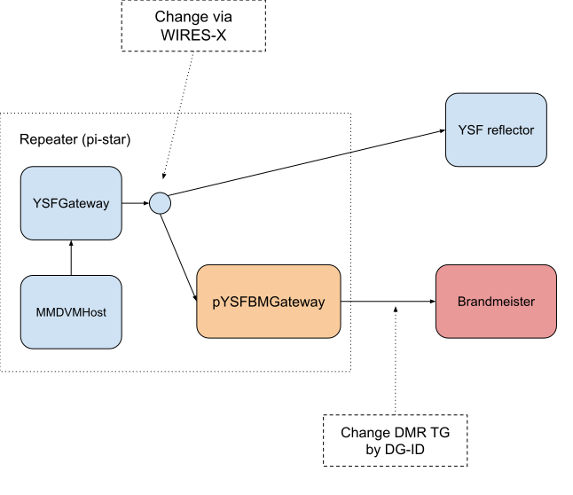

# YSFBMDirect

YSFBMDirect is a software that allows you to access Brandmeister as if it were a YSF reflector.
It works by using the YSF Direct protocol that is being currently experimented.

The goal of this software is to build a YSF repeater that can connect to Brandmeister Talk Groups,
without losing the possibility to connect to other YSF rooms.

By adding YSFBMDirect to your `YSFHosts.txt` file, you can connect to it through WIRES-X.
Then, exit from the WIRES-X mode and simply change the TX DG-ID of your radio to change the DMR Talk Group.

When you make a short transmission just to change the Talk Group, it won't be sent to Brandmeister.
YSFBMDirect will acknowledge change with a short transmission, showing the Talk Group number as the callsign.



# Installation

### Automatic Installation on Pi-Star

Go to your pi-star dashboard, Configuration > Expert > SSH Access, then login with your credentials
(user `pi-star` and password `raspberry` by default).

Paste the following command:

```bash
rpi-rw && curl https://raw.githubusercontent.com/stefanolande/YSFBMDirect/master/install.sh | bash -
```

The installer will:
- Install `uv` package manager (10-100x faster than pip)
- Clone the repository
- Create virtual environment
- Install dependencies
- Set up configuration file (YAML format)
- Install and start systemd service
- Add YSF-BM to your YSFHosts.txt

You can edit your configuration file during the installation wizard, or later with:

```bash
rpi-rw && sudo nano /opt/YSFBMDirect/config.yaml
```

Here's a [video](https://www.youtube.com/watch?v=_kqUQTMxKBU) showing the installation process (note: video shows v1.0, v2.0 is similar but uses YAML config).

### Manual Installation (Pi-Star or Linux)

```bash
# Install uv (fast Python package manager)
curl -LsSf https://astral.sh/uv/install.sh | sh

# Clone repository
git clone https://github.com/stefanolande/YSFBMDirect.git
cd YSFBMDirect

# Create and configure config file
cp config.example.yaml config.yaml
nano config.yaml  # Set your callsign, password, and talk groups

# Install to /opt (or any directory you prefer)
sudo mv YSFBMDirect /opt/
cd /opt/YSFBMDirect/

# Create virtual environment and install
uv venv
uv pip install -e "."

# Install systemd service
sudo cp ysfbmdirect.service /etc/systemd/system/
sudo systemctl daemon-reload
sudo systemctl enable ysfbmdirect.service
sudo systemctl start ysfbmdirect.service

# Add YSF-BM to YSFHosts.txt (pi-star only)
echo "01234;YSF-BM;YSF-BM;127.0.0.1;42002;001" >> /root/YSFHosts.txt
/usr/local/sbin/HostFilesUpdate.sh
```

**Note:** `01234` is the YSF Room code, `YSF-BM` is the room name (changeable), and `42002` is the default port (configurable in `config.yaml` as `ysf_port`).

### Development Setup

For development with full test suite and tooling:

```bash
# Install uv
curl -LsSf https://astral.sh/uv/install.sh | sh

# Clone and setup
git clone https://github.com/stefanolande/YSFBMDirect.git
cd YSFBMDirect

# Create virtual environment
uv venv
source .venv/bin/activate  # On Windows: .venv\Scripts\activate

# Install with development dependencies
uv pip install -e ".[dev]"

# Copy example config
cp config.example.yaml config.yaml
nano config.yaml

# Run tests (61 tests covering all components)
pytest

# Run with coverage
pytest --cov=ysfbmdirect --cov-report=html

# Type check
mypy ysfbmdirect

# Lint and format
ruff check .
ruff format .

# Run application
ysfbmdirect config.yaml
# or: python -m ysfbmdirect.main config.yaml
```

## Configuration File Format

YSFBMDirect uses YAML configuration format. See `config.example.yaml` for full example:

```yaml
connection:
  callsign: YOUR_CALLSIGN
  bm_password: YOUR_PASSWORD
  bm_host: 44.131.4.1
  bm_port: 42000
  ysf_port: 42002

talkgroups:
  default_tg: 2225
  default_dgid: 10

  dgid_to_tg:
    10: 2225
    31: 2231
    # Add more DG-ID to TG mappings
```

## Configuration Options

### Talk Groups Mapping

Map DG-IDs (00-99) to Brandmeister Talk Groups:

```yaml
talkgroups:
  dgid_to_tg:
    10: 2225  # DG-ID 10 -> TG 2225
    31: 2231  # DG-ID 31 -> TG 2231
    91: 91    # DG-ID 91 -> TG 91 (Worldwide)
```

You can add up to 99 mappings (DG-IDs 00-99). Each DG-ID must be unique, and each TG can only appear once.

### Additional Settings

#### Back to Default Talk Group

Automatically return to the default TG after a period of inactivity:

```yaml
back_to_default_seconds: 300  # 5 minutes, or 0 to disable
```

#### Show DG-ID with Callsign

Display the current DG-ID alongside incoming callsigns (e.g., `91/N1ABC`):

```yaml
show_dgid_callsign: true
```

This helps you remember which TG you're currently using.

#### Silence Period Before TG Change

Require a silence period before allowing TG changes (prevents accidental changes):

```yaml
tg_change_silence_period: 5.0  # seconds, or 0 to disable
```

During this period, transmissions use the current TG even if the DG-ID differs.

## Acknowledgements

* Stefano IS0EIR: Author
* Bruno IS0GQX: Feature advisor and tester
* Luca IS0GVH: Code reviews
* Martino Mori IU4QTF: Fix for the transmission to indicate the Talk Group change

We also thank [Antonio IU5JAE](https://github.com/iu5jae/), whose open-source code was extremely useful for this project. 

## Web UI

YSFBMDirect v2.0 includes a built-in web interface for monitoring and configuration.

### Access the Web UI

If enabled in your configuration, access the web interface at:

```
http://localhost:8080
```

Or if running on a remote server:

```
http://your-server-ip:8080
```

### Configuration

Enable the web UI in `config.yaml`:

```yaml
webui:
  enabled: true           # Enable/disable web interface
  host: 0.0.0.0          # Listen on all interfaces
  port: 8080             # Web UI port
```

**Security Note:** The web UI currently has no authentication. If exposing to the internet, use a reverse proxy (nginx, Apache) with authentication, or set `host: 127.0.0.1` to allow local access only.

### Using the Web UI

**Manual TG Change:**

1. **Quick Access Buttons:** Click any TG button to instantly change talk groups
   - Buttons show all configured TG mappings
   - Hover to see DG-ID mapping
   - Change takes effect immediately

2. **Manual Entry:** Enter any TG number and click "Change"
   - Works with TGs configured in your `dgid_to_tg` mapping
   - Shows success/error messages
   - All connected clients see the change in real-time

**Configuration Editor:**

1. **Load:** Configuration loads automatically on page load, or click "Load" to refresh
2. **Edit:** Modify the YAML configuration directly in the browser
3. **Validate:** Click "Validate" to check for errors before saving
4. **Save:** Click "Save" to write changes to `config.yaml`
   - Confirmation dialog appears
   - Restart required to apply changes
   - Warning displayed after saving